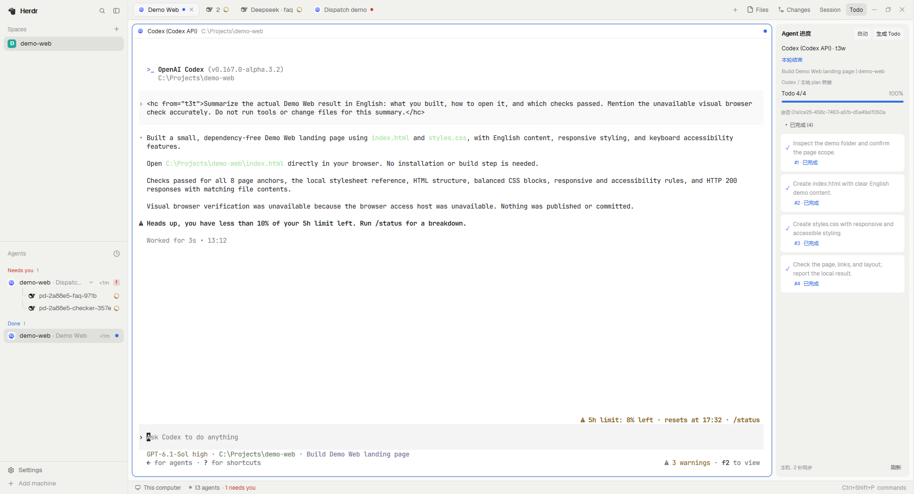
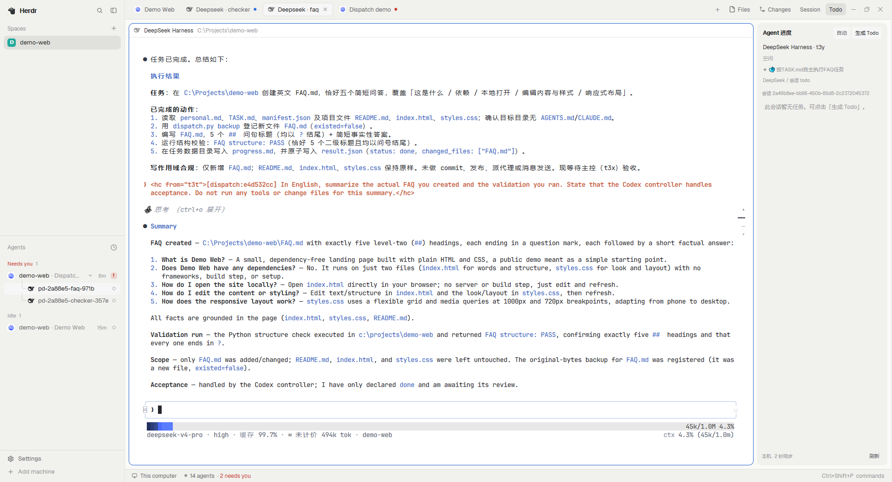
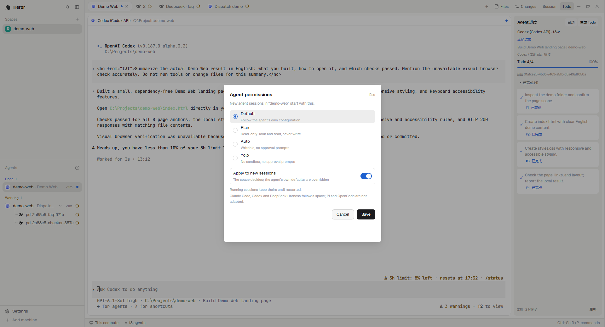
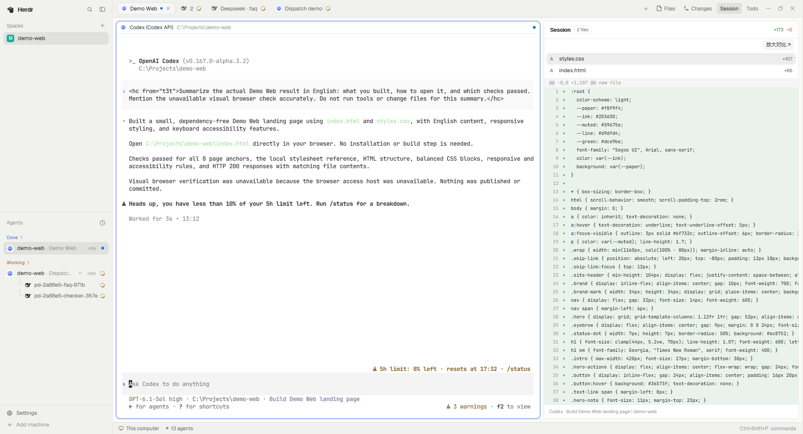
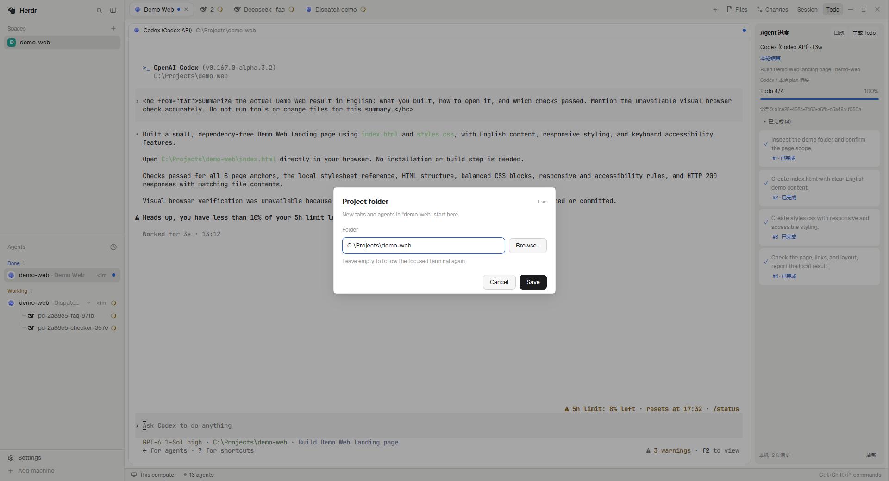

# Herdr Extensions

<details name="language" open>
<summary><b>English</b></summary>

Make agent work easier to follow: live plans, conversation diffs, project Spaces, permissions, and autonomous dispatch.

### Installation

Install **Herdr App, Python 3.10+**, and the agent CLIs you use. These panels follow local agent sessions.

```sh
git clone https://github.com/AkaCMD/cmd-herdr-extensions.git
cd cmd-herdr-extensions

# Preview first; this command changes nothing.
python scripts/install.py agent-todos

# Install the collector dependency with the Python Herdr uses.
python -m pip install -r mods/agent-todos/requirements.txt
python scripts/install.py agent-todos --apply
```

In **Settings → Look → Layout**, choose **agent-progress**, then select a local agent terminal. Run `/reload` in Pi to load its extension.

Add other features as needed; follow their activation steps below.

| Extension | Purpose | Activation |
|---|---|---|
| `agent-todos` | Live Todo & Plan | Install `psutil`, select layout |
| `personal-dispatch` | Autonomous dispatch | Register the host plugin |
| `session-changes` | Conversation files & diffs | Enable Session in the layout |
| `space-project` | Project folder per Space | Install Session first, then enable folders |
| `space-permissions` | Permissions for new sessions | Requires Space menu and launcher hook |

The installer previews by default and stops on conflicting files. After reviewing them, use `--apply --replace` to back up and replace; backups go to `.local/backups/` in this checkout. Set `--herdr-home` / `HERDR_APP_HOME` or `--pi-home` for custom locations. Copying files does not select the layout or register the dispatch plugin.

### 1. Todo / Plan — follow the selected agent

Install `agent-todos` and its Python dependency, select the **agent-progress** layout, then select a local agent terminal. Ask the agent to maintain a plan as it works. **生成 Todo** requests a checklist; **自动** tries once for a conversation without tasks. Completed items can be collapsed, and the panel follows agent selection.

Generating a checklist sends a message to the agent. A working agent is interrupted first, then asked to update its plan and resume the original task. Resolve any pending terminal prompt before generating. Auto mode skips existing tasks and collector errors.



### 2. Dispatch — delegate and verify

Install `personal-dispatch`, then register it for the host you use:

```sh
python scripts/install.py personal-dispatch
python scripts/install.py personal-dispatch --apply
python plugins/herdr-personal-dispatch/install.py --host codex
# For Claude:
python plugins/herdr-personal-dispatch/install.py --host claude
```

Open a new agent session **inside Herdr**:

```text
$dispatch Use two DeepSeek workers: one writes the website FAQ, the other a page checker.
Act as the Codex controller. Check the actual files and validation results before accepting.
```

Use `/herdr-personal-dispatch:dispatch` in Claude. Codex or Claude can control the run; Codex, Claude and DeepSeek can execute jobs in separate interactive tabs. The default concurrency is two. The controller handles dependencies, verification, acceptance, pause and resume. Requires live `hc` and the selected agent CLIs; DeepSeek additionally requires configured `dsh-tui --backend dsh`.

The screenshot shows a Codex controller dispatching real DeepSeek jobs for `FAQ.md` and `check_page.py`.



See the [dispatch guide](plugins/herdr-personal-dispatch/README.md) and [command reference](plugins/herdr-personal-dispatch/skills/dispatch/references/runtime.md).

### 3. Space permissions — defaults for new sessions

Right-click a Space → **Agent permissions…**, choose a profile, enable **Apply to new sessions**, and save.

| Profile | Behavior |
|---|---|
| Default | Follows the agent's own configuration |
| Plan | Read-only |
| Auto | Writable, no tool approval prompts |
| Yolo | No sandbox, no approval prompts; extra confirmation on save |

Turning the switch off keeps the selection as a note only. Existing sessions keep their permissions until restarted. Claude Code, Codex and DeepSeek Harness are adapted; Pi and OpenCode are not.

Install the Space menu and launcher support:

```sh
python scripts/install.py session-changes --apply
python scripts/install.py space-project --apply
python scripts/enable_session_changes.py agent-progress --apply
python scripts/enable_space_project.py agent-progress --apply
python scripts/install.py space-permissions --apply
python scripts/enable_permissions.py          # preview launcher changes first
python scripts/enable_permissions.py --apply
```

On Windows, a compatible existing `data/codex-bridge/launch.py` is required; the complete launch bridge is not bundled. On Unix without that bridge, the script can wrap supported native launchers in `programs.json`. Installing the dialog alone does not apply a profile.



### 4. Session — review conversation changes

```sh
python scripts/install.py session-changes --apply
python scripts/install.py space-project --apply
python scripts/enable_session_changes.py agent-progress --apply
```

Click **Session**, select a file, and use **放大对比 ↗** for a larger view. Text diffs and supported structured comparisons follow the selected conversation. Helper scripts are hidden by default and can be shown with the footer toggle.



### 5. Project folder — start new tabs in the right directory

After installing Session and `space-project`, enable the Space layout:

```sh
python scripts/enable_space_project.py agent-progress
python scripts/enable_space_project.py agent-progress --apply
```

Right-click a Space → **Project folder…**, choose an existing directory and save. New tabs and agents opened through the project menus start there; existing terminals keep their directory. The script adds the layout-specific `Ctrl+Shift+T` binding when free and preserves conflicting bindings. **Clear** restores following the focused terminal.



### Validation & troubleshooting

- **`No module named psutil`**: install the dependency into the Python interpreter Herdr actually runs.
- **Files copied but the panel doesn't appear**: select the layout and apply the relevant activation script.
- **Menu appears but permissions don't apply**: verify the launcher hook and start a new session.
- **Layout patch rejects `main` and other shipped layouts**: use the bundled personal layout or clone a shipped one first.

```sh
herdr-app check agent-todos
herdr-app check session-changes
herdr-app status
python -m unittest discover -s scripts -p test_install.py -v
python -m unittest discover -s plugins/herdr-personal-dispatch/tests -v
```

A mod check validates initial loading, not every interactive state. Screenshots show the captured demo scenarios; parser tests do not establish full live coverage across agents, systems, formats or recovery cases.

### Source

| Path | Contents |
|---|---|
| [extensions.json](extensions.json) | Install manifest |
| [mods/](mods/) | Native panels and menus |
| [layouts/](layouts/) | Personal layout |
| [pi/extensions/](pi/extensions/) | Pi integration |
| [bridge/](bridge/) | Permission launcher module |
| [plugins/](plugins/) | Dispatch plugin |
| [scripts/](scripts/) | Install, activation and tests |

</details>

<details name="language">
<summary><b>中文</b></summary>

让代理工作看得见、跟得上：实时计划、会话改动、项目空间、空间权限与自主调度。

### 安装

需要已安装的 **Herdr App、Python 3.10+**，以及你要使用的代理 CLI。面板读取本机代理会话；远程代理不在本文演示范围内。

```sh
git clone https://github.com/AkaCMD/cmd-herdr-extensions.git
cd cmd-herdr-extensions

# 先预览，不写入。
python scripts/install.py agent-todos

# 用 Herdr 实际调用的 Python 安装采集器依赖。
python -m pip install -r mods/agent-todos/requirements.txt
python scripts/install.py agent-todos --apply
```

在 Herdr 的 **Settings → Look → Layout** 选择 **agent-progress**，选中一个本机代理终端。使用 Pi 时执行 `/reload` 加载扩展。

按需安装其他功能；各项的启用步骤见下方指南。

| 安装名 | 功能 | 后续步骤 |
|---|---|---|
| `agent-todos` | 实时任务 | 安装 `psutil`，选择布局 |
| `personal-dispatch` | 自主调度 | 注册客户端插件 |
| `session-changes` | 会话文件与 diff | 启用 Session 布局补丁 |
| `space-project` | Space 项目目录 | 先安装 Session，再启用目录 |
| `space-permissions` | 新会话权限 | 需要 Space 菜单与启动器 hook |

安装器默认只预览。文件有冲突时会停止；核对差异后可用 `--apply --replace` 备份并替换，备份位于仓库 `.local/backups/`。默认目标为 `~/.config/herdr-app`，可用 `--herdr-home` 或 `HERDR_APP_HOME` 指定；Pi 默认目标为 `~/.pi/agent`，可用 `--pi-home` 指定。安装器仅复制清单文件，不会自动切换布局或完成插件注册。

### 1. Todo / Plan：跟随当前代理的任务清单

选中代理终端，右侧 **Agent 进度** 面板展示当前会话的任务、进行中步骤和完成比例。支持 Claude Code、Codex、Pi 和 DeepSeek Harness 的本机会话；具体任务格式由各代理采集器适配。

1. 按上面的安装步骤启用 `agent-todos` 和布局。
2. 在真实任务中让代理维护计划，例如：`为这个页面列出四步计划，完成一步就更新状态。`
3. 没有清单时点 **生成 Todo**。开启 **自动** 后，切换到没有任务的会话时会尝试生成一次。
4. 切换代理，面板自动跟随；完成项可以折叠，**刷新** 可立即重新读取。

**生成 Todo 会向代理发送请求。** 工作中的代理会先被暂停，更新清单后继续原任务；等待你回复的代理需要先处理终端提示。自动模式会跳过已有任务或存在采集错误的会话。


源码：[Todo 面板](mods/agent-todos/) · [Pi 任务扩展](pi/extensions/herdr-todos.ts)

### 2. Dispatch：一个主控，拆分、派发与验收

在 Herdr 中让 Codex 或 Claude Code 作为主控，将目标拆成任务，由 Codex、Claude Code 或 DeepSeek 执行。任务在独立 tab 中保持可交互，主控负责依赖顺序、检查与验收。默认最多两路同时执行，支持暂停、恢复和文件范围互斥；可以直接在普通目录中使用。

先复制并注册插件：

```sh
python scripts/install.py personal-dispatch
python scripts/install.py personal-dispatch --apply
python plugins/herdr-personal-dispatch/install.py --host codex
# 使用 Claude 时：
python plugins/herdr-personal-dispatch/install.py --host claude
```

新开一个 **Herdr 中的代理会话**，输入目标：

```text
$dispatch 用 DeepSeek 执行两项独立任务：编写网站 FAQ 和编写页面检查脚本，最多两路。
你作为 Codex 主控，检查实际文件和验证结果，完成后汇报。
```

Claude 的入口为 `/herdr-personal-dispatch:dispatch`。用“暂停当前调度”暂停；用“恢复 RUN”恢复已有调度。需要在线 `hc`、可用的代理 CLI；使用 DeepSeek 时还需要配置好的 `dsh-tui --backend dsh`。

截图中的 Codex 主控实际调用两路 DeepSeek，分别编写 `FAQ.md` 和 `check_page.py`。


[完整调度说明](plugins/herdr-personal-dispatch/README.md) · [命令与任务格式](plugins/herdr-personal-dispatch/skills/dispatch/references/runtime.md)

### 3. 空间权限：为新会话选择权限档位

右键 Space → **Agent permissions…**，选择档位，打开 **Apply to new sessions** 后保存。随后在这个 Space 中新开的受支持代理会话会应用该配置；已运行会话需要重新启动才会改变。

| 档位 | 行为 |
|---|---|
| Default | 跟随代理自身配置 |
| Plan | 只读查看 |
| Auto | 可写入，不弹工具审批提示 |
| Yolo | 无沙箱，不弹工具审批提示；保存时额外确认 |

关闭 **Apply to new sessions** 后只保留选择，不实际应用。当前启动器适配 **Claude Code、Codex 和 DeepSeek Harness**；Pi 与 OpenCode 尚未适配。显式启动参数仍可能覆盖档位。

安装 Space 菜单与启动器支持：

```sh
python scripts/install.py session-changes --apply
python scripts/install.py space-project --apply
python scripts/enable_session_changes.py agent-progress --apply
python scripts/enable_space_project.py agent-progress --apply
python scripts/install.py space-permissions --apply
python scripts/enable_permissions.py          # 先预览启动器修改
python scripts/enable_permissions.py --apply
```

Windows 需要已有兼容的 `data/codex-bridge/launch.py`；本仓库仅提供权限模块，不提供完整启动桥。没有启动桥时，脚本会报错。Unix 无启动桥时可包装本机 `programs.json` 中的受支持启动器。只有菜单安装完成还不足以让权限生效。


源码：[权限面板](mods/space-permissions/) · [启动器权限模块](bridge/permissions.py)

### 4. Session：检查本次对话改了什么

```sh
python scripts/install.py session-changes --apply
python scripts/install.py space-project --apply
python scripts/enable_session_changes.py agent-progress --apply
```

点标签栏 **Session**，选中文件查看 diff，再点 **放大对比 ↗** 查看大窗口。面板跟随当前代理会话，支持文本改动、结构化表格 / JSON 等前后比较，以及受支持的资产记录。辅助脚本默认折叠，可通过面板底部开关显示。安装 `space-project` 是因为 Session 的标签栏同时使用其菜单组件。


源码：[Session 面板与采集器](mods/session-changes/)

### 5. 空间目录：新 tab 从项目目录开始

在上节安装 Session 和 `space-project` 后，启用 Space 布局：

```sh
python scripts/enable_space_project.py agent-progress
python scripts/enable_space_project.py agent-progress --apply
```

右键 Space → **Project folder…** → 选择已存在的目录 → **Save**。此后通过项目菜单新建的 tab / agent 从该目录启动；脚本也尝试为此布局设置 `Ctrl+Shift+T`，已有不同绑定会保留并提示。现有终端不会切换目录。点 **Clear** 可恢复跟随当前终端目录。


源码：[目录对话框](mods/space-folder/) · [Space 列表](mods/spaces-project/) · [项目菜单](mods/menu-project/)

### 验证与排错

- **`No module named psutil`**：用 Herdr 调用的同一个 Python 执行 `python -m pip install -r mods/agent-todos/requirements.txt`。如果使用虚拟环境，确保面板的 Python 能找到依赖。
- **文件已复制但面板没出现**：选择 `agent-progress` 布局，检查对应启用脚本是否运行。布局补丁默认只预览，加 `--apply` 才写入。
- **菜单出现但权限未生效**：检查启动器 hook，并新开会话；运行中的会话保持原配置。
- **布局补丁拒绝 `main` 等官方布局**：使用随仓库提供的个人布局，或先克隆官方布局；补丁依赖 `tabs`、`panel-body` 等节点。

```sh
herdr-app check agent-todos
herdr-app check session-changes
herdr-app status
python -m unittest discover -s scripts -p test_install.py -v
python -m unittest discover -s plugins/herdr-personal-dispatch/tests -v
```

`herdr-app check` 检查 mod 初始加载，不能替代窗口内交互验证。截图只证明展示场景；合成解析测试不能等同所有代理、系统、资产格式和重连场景均通过真实验证。

### 源码

| 路径 | 内容 |
|---|---|
| [extensions.json](extensions.json) | 安装文件清单 |
| [mods/](mods/) | 原生 Herdr 面板与菜单 |
| [layouts/](layouts/) | 个人布局 |
| [pi/extensions/](pi/extensions/) | Pi 集成 |
| [bridge/](bridge/) | 权限启动模块 |
| [plugins/](plugins/) | 调度插件 |
| [scripts/](scripts/) | 安装、布局启用与测试 |

</details>
