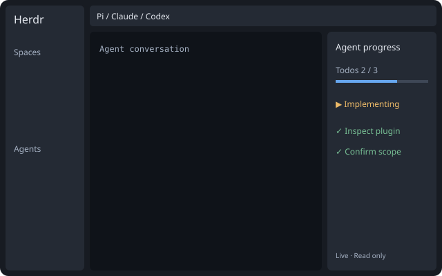

# Herdr Extensions

Personal Herdr extensions for Claude Code, Codex, Pi, and DeepSeek Harness (dsh-tui): a live Agent todo/progress panel, a session changes viewer, per-Space project folders and agent permissions, and an autonomous multi-agent dispatcher.

个人 Herdr 扩展集合：实时 Agent 进度面板、会话改动对比、Space 目录与权限，以及自主多智能体调度。支持 Claude Code、Codex、Pi 与 DeepSeek Harness（dsh-tui）。

**[English](#english) · [中文](#中文)**

## 预览 / Preview



> `layouts/agent-progress.svg` 是布局示意图，不是真实聊天截图。 / This is a layout diagram, not a real chat screenshot.

---

## English

### Features

| Feature | Description | Source |
|---|---|---|
| Live Todo / Plan panel | Follows the selected agent, shows todo / plan, one-click generation | `mods/agent-todos/`, `pi/extensions/herdr-todos.ts` |
| Session changes | Shows files and diffs changed in the current conversation (text / tables / JSON / assets) | `mods/session-changes/`, `mods/tabs-session/` |
| Space project folder | Assign a working directory to a Space; new tabs / agents start from it | `mods/space-folder/`, `mods/spaces-project/`, `mods/menu-project/`, `mods/new-menu-project/` |
| Space agent permissions | Per-Space permission profile (Plan / Auto / Yolo) applied to new sessions | `mods/space-permissions/`, `bridge/permissions.py` |
| Autonomous dispatch | Codex / Claude as controller; auto split, dispatch, verify | `plugins/herdr-personal-dispatch/` |

Works on Windows / Linux with local Claude Code, Codex, Pi, and DeepSeek Harness (dsh-tui).

### Quick start

1. Install (preview by default; add `--apply` to write):

   ```sh
   python scripts/install.py <extension> --apply
   ```

   `<extension>` is one of `agent-todos`, `session-changes`, `space-project`, `space-permissions`, `personal-dispatch`.

2. In Herdr: select an agent to see the Todo / Plan panel; open the **Session** tab for file changes; right-click a Space for its folder or permissions; start a Codex session with `$dispatch` or a Claude session with `/herdr-personal-dispatch:dispatch` for autonomous dispatch.

### Usage

- **Todo / Plan panel** — select an agent; the panel follows automatically. Click "生成 Todo" when you need a checklist; enable "自动" to generate on tab switch.
- **Session panel** — click the **Session** tab to see changed files and diffs; pick an entry and "放大对比 ↗" for detail.
- **Space project folder** — right-click a Space → `Project folder…`.
- **Space agent permissions** — right-click a Space → `Agent permissions…`.
- **Autonomous dispatch** — describe your goal in a new Codex (`$dispatch`) or Claude (`/herdr-personal-dispatch:dispatch`) session; the controller plans, splits, dispatches, and verifies.

### Requirements

Windows / Linux, Python 3.10+. The dispatch plugin additionally requires Herdr App / `hc` and the agent CLIs you use (DeepSeek via local `dsh-tui --backend dsh`).

### License & privacy

MIT. This repository contains only source, synthetic tests, and docs — no credentials, session data, or real machine paths.

---

## 中文

### 功能一览

| 功能 | 说明 | 源码 |
|---|---|---|
| 实时 Todo / Plan 面板 | 跟随选中代理展示 todo / plan，支持一键生成 | `mods/agent-todos/`、`pi/extensions/herdr-todos.ts` |
| Session 面板 | 展示本次对话改动的文件与 diff（文本 / 表格 / JSON / 资产） | `mods/session-changes/`、`mods/tabs-session/` |
| Space 项目目录 | 为 Space 指定目录，其下新建的 tab / agent 从此目录启动 | `mods/space-folder/`、`mods/spaces-project/`、`mods/menu-project/`、`mods/new-menu-project/` |
| 单空间 agent 权限 | 为 Space 指定权限档位（Plan / Auto / Yolo）并应用到新会话 | `mods/space-permissions/`、`bridge/permissions.py` |
| 个人自主调度 | Codex / Claude 主控，自动拆分、派发、验收 | `plugins/herdr-personal-dispatch/` |

支持 Windows / Linux 本机的 Claude Code、Codex、Pi 与 DeepSeek Harness（dsh-tui）。

### 快速开始

1. 安装（默认只预览，加 `--apply` 写入）：

   ```sh
   python scripts/install.py <扩展名> --apply
   ```

   `<扩展名>` 为 `agent-todos`、`session-changes`、`space-project`、`space-permissions`、`personal-dispatch`。

2. 在 Herdr 中：选中代理查看 Todo / Plan 面板；点 **Session** 标签看文件改动；右键 Space 设目录或权限；Codex 新会话输入 `$dispatch`、Claude 输入 `/herdr-personal-dispatch:dispatch` 触发自主调度。

### 使用说明

- **Todo / Plan 面板** — 选中代理终端，面板自动跟随；需要清单时点「生成 Todo」，开启「自动」后切换对话即自动生成。
- **Session 面板** — 点标签栏 **Session** 按钮查看本次对话改动的文件与 diff，选中一条点「放大对比 ↗」看详情。
- **Space 项目目录** — 右键 Space → `Project folder…`。
- **单空间 agent 权限** — 右键 Space → `Agent permissions…` 选档位。
- **个人自主调度** — 在 Herdr 里新开 Codex 会话用 `$dispatch`、Claude 用 `/herdr-personal-dispatch:dispatch`，直接描述目标即可。

### 目录结构

```
extensions.json         安装清单：扩展名 → { herdr | pi | plugin | bridge: [文件] }
layouts/                个人布局
mods/<功能名>/          Herdr mod 源码
pi/extensions/          Pi 扩展
bridge/                 启动桥模块
plugins/<插件名>/       Codex / Claude 技能插件
scripts/install.py      按清单预览 / 安装
scripts/enable_*.py     对布局、keys.json、launch.py 做幂等改写
```

### 安装与测试

各扩展都用 `scripts/install.py`，默认只预览：

```sh
python scripts/install.py <扩展名>            # 预览
python scripts/install.py <扩展名> --apply    # 写入
python scripts/install.py <扩展名> --apply --replace  # 冲突时备份后覆盖
```

测试：

```powershell
python -m unittest discover -s plugins/herdr-personal-dispatch/tests -v
python -m unittest discover -s scripts -p test_install.py -v
# 其余扩展测试见各 mod 目录
```

### 隐私与归属

仓库只保存源码、合成测试与说明；聊天日志、任务快照、会话数据库、凭据与依赖二进制不提交。面板与调度仅在本机读取代理进程与会话数据。MIT。
